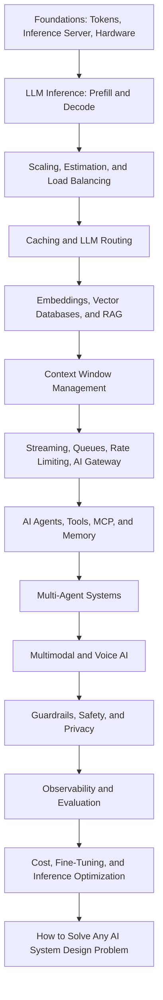

# 学习路径 {#ai-system-design-learning-path}

我是 **Amit Shekhar** ，[Outcome School](https://outcomeschool.com) 的创始人，我教导和指导过许多开发人员，他们的努力为他们带来了高薪技术工作，帮助许多科技公司解决了他们的独特问题，并创建了许多被顶级公司使用的开源库。我热衷于通过开源、博客和视频分享知识。

我在 Outcome School 教授 [AI 和机器学习](https://outcomeschool.com/program/ai-and-machine-learning)。

让我们开始吧。
